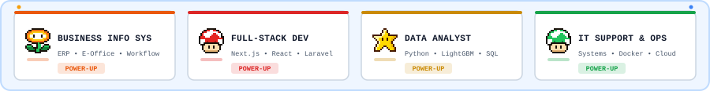

<!-- Auto Light/Dark Super Mario Bros Animated Hero Banner -->
<picture>
  <source media="(prefers-color-scheme: dark)" srcset="./assets/mario-hero-dark.svg" />
  <source media="(prefers-color-scheme: light)" srcset="./assets/mario-hero-light.svg" />
  
</picture>

 
 

<!-- Quick Warp Pipes (Navigation & Contact) -->

---

## 🕹️ Player 1 Select — About Me

Hi! I'm **I Kadek Agga Sugitha**, a **Full-Stack Software Engineer & AI/ML Developer** from Indonesia who enjoys building scalable web applications, intelligent decision-support systems, and production-ready backend architectures.

- 🍄 **Currently Building:** AI-assisted learning platforms (**[Simulasi CPNS](https://github.com/ikadekaggasugitha-cell/Simulasi_CPNS)**) & quantitative stock analytics (**[AIDSS](https://github.com/ikadekaggasugitha-cell/AI-InvestmentDecisionSupport)**)
- 🔥 **Core Focus:** Modern Full-Stack Web (`React`, `Next.js`, `TypeScript`, `Laravel`), High-Performance APIs (`FastAPI`, `Fastify`, `Spring Boot`), and Applied Machine Learning (`Python`, `LightGBM`, LLM integrations)
- ⭐ **Engineering Philosophy:** Clean architecture, type safety, containerized workflows (`Docker`), and shipping software that solves real-world problems
- 📬 **Warp Zone (Contact):** [ikadekaggasugitha@gmail.com](mailto:ikadekaggasugitha@gmail.com)

  <picture>
    <source media="(prefers-color-scheme: dark)" srcset="./assets/mario-powerups-dark.svg" />
    <source media="(prefers-color-scheme: light)" srcset="./assets/mario-powerups-light.svg" />
    
  </picture>

---

## ⚡ Power-Up Arsenal

| Category | Equipped Power-Ups |
| :--- | :--- |
| **🎮 Languages** |       |
| **🔥 Frontend** |      |
| **🍄 Backend** |       |
| **⭐ AI & Data** |        |
| **🟩 Data & Infra** |         |

 

  <picture>
    <source media="(prefers-color-scheme: dark)" srcset="./assets/mario-divider-dark.svg" />
    <source media="(prefers-color-scheme: light)" srcset="./assets/mario-divider-light.svg" />
    
  </picture>

---

## 🗺️ World Map — Featured Quests

<table>
  <tr>
    <td width="50%" valign="top">
      <h3>⭐ World 1-1 · <a href="https://github.com/ikadekaggasugitha-cell/AI-InvestmentDecisionSupport">AIDSS (AI Investment Decision Support)</a></h3>
      
Quantitative decision-support platform for the Indonesia Stock Exchange (IDX) featuring <strong>LightGBM + SHAP</strong> trading signals, <strong>GARCH / CVaR</strong> risk modeling, <strong>Black-Litterman + HRP</strong> portfolio optimization, and a streaming <strong>Claude AI</strong> advisor.

      
<code>Python</code> <code>FastAPI</code> <code>React</code> <code>TypeScript</code> <code>TimescaleDB</code> <code>Redis</code> <code>Celery</code> <code>Docker</code>

    </td>
    <td width="50%" valign="top">
      <h3>🍄 World 1-2 · <a href="https://github.com/ikadekaggasugitha-cell/Simulasi_CPNS">Simulasi CPNS Platform</a></h3>
      
Modern interactive CPNS learning &amp; exam simulation web application with JWT authentication, smooth motion UI, and <strong>Google Gemini AI</strong> integration for adaptive study support.

      
<code>React 19</code> <code>TypeScript</code> <code>Vite</code> <code>Tailwind v4</code> <code>Express</code> <code>Firebase</code> <code>SQLite</code> <code>Gemini AI</code>

    </td>
  </tr>
  <tr>
    <td width="50%" valign="top">
      <h3>🔥 World 1-3 · <a href="https://github.com/ikadekaggasugitha-cell/Web_Mobile_Apps_byOblintz_parfume">OBLINTZ Perfume E-Commerce</a></h3>
      
Full-stack luxury fragrance e-commerce monorepo with interactive scent-recommendation quiz, subscription flows, gift-wrapping cart, <strong>Midtrans QRIS</strong> checkout, and a dedicated Admin Panel.

      
<code>Next.js 14</code> <code>Fastify</code> <code>Prisma</code> <code>PostgreSQL</code> <code>Redis</code> <code>TypeScript</code> <code>Midtrans</code>

    </td>
    <td width="50%" valign="top">
      <h3>🏰 World 1-4 · <a href="https://github.com/ikadekaggasugitha-cell/E-Office_Digital-Sistem-Surat-Disposisi">SIP Arsip Digital (E-Office)</a></h3>
      
Enterprise digital correspondence, mail disposition, document retention, and multi-stage approval workflow engine built for PT Sinergi Properti with PDF generation &amp; digital signatures.

      
<code>Laravel 11</code> <code>Filament 3</code> <code>PHP 8.2+</code> <code>Tailwind CSS</code> <code>Puppeteer</code> <code>Docker</code>

    </td>
  </tr>
  <tr>
    <td width="50%" valign="top">
      <h3>🚀 World 2-1 · <a href="https://github.com/ikadekaggasugitha-cell/Portfolio.site">Portfolio.site Architecture</a></h3>
      
Production-ready personal portfolio built with a decoupled <strong>Next.js App Router</strong> frontend and <strong>Laravel 11 JWT API</strong> backend, SSL-managed MySQL (Aiven), Docker Compose, and Vercel deployment.

      
<code>Next.js</code> <code>Laravel 11</code> <code>JWT</code> <code>MySQL SSL</code> <code>Docker</code> <code>Vercel</code>

    </td>
    <td width="50%" valign="top">
      <h3>📊 World 2-2 · <a href="https://github.com/ikadekaggasugitha-cell/DataScience">Data Science</a> &amp; Backend APIs</h3>
      
Machine Learning, EDA &amp; NLP research notebooks (<a href="https://github.com/ikadekaggasugitha-cell/DataScience">DataScience</a>), plus production-style backend engineering challenges in <strong>Java Spring Boot</strong> (<a href="https://github.com/ikadekaggasugitha-cell/allobank_test">Split-Bill API</a>) and <strong>Node.js Express</strong> (<a href="https://github.com/ikadekaggasugitha-cell/technical-test-huawei">Analytics API</a>).

      
<code>Jupyter</code> <code>Scikit-Learn</code> <code>XGBoost</code> <code>Java</code> <code>Spring Boot</code> <code>Node.js</code>

    </td>
  </tr>
</table>

---

## 🏆 Player 1 Arcade Status

  <picture>
    <source media="(prefers-color-scheme: dark)" srcset="./assets/mario-arcade-stats-dark.svg" />
    <source media="(prefers-color-scheme: light)" srcset="./assets/mario-arcade-stats-light.svg" />
    
  </picture>

 

  <!-- Auto Light/Dark Super Mario Bros Course Clear Castle Footer -->
  <picture>
    <source media="(prefers-color-scheme: dark)" srcset="./assets/mario-footer-dark.svg" />
    <source media="(prefers-color-scheme: light)" srcset="./assets/mario-footer-light.svg" />
    
  </picture>

