<!-- Auto Light (Sunny Day) / Dark (Starry Night) Super Mario Bros Hero Banner -->
<picture>
  <source media="(prefers-color-scheme: dark)" srcset="./assets/mario-hero-dark.svg" />
  <source media="(prefers-color-scheme: light)" srcset="./assets/mario-hero-light.svg" />
  
</picture>

 
 

<!-- Warp Pipe Social Icons (icon-only, click to open) -->
<a href="https://www.linkedin.com/in/ikadekagga" title="LinkedIn">
  <picture>
    <source media="(prefers-color-scheme: dark)" srcset="./assets/mario-social-linkedin-dark.svg" />
    
  </picture>
</a>
&nbsp;
<a href="https://api.whatsapp.com/send?phone=62881025268810" title="WhatsApp">
  <picture>
    <source media="(prefers-color-scheme: dark)" srcset="./assets/mario-social-whatsapp-dark.svg" />
    
  </picture>
</a>
&nbsp;
<a href="https://www.instagram.com/kadekagga?utm_source=qr&amp;bqrl=eGgwdDdrNXJ0dzMy" title="Instagram">
  <picture>
    <source media="(prefers-color-scheme: dark)" srcset="./assets/mario-social-instagram-dark.svg" />
    
  </picture>
</a>
&nbsp;
<a href="mailto:ikadekaggasugitha@gmail.com" title="Email">
  <picture>
    <source media="(prefers-color-scheme: dark)" srcset="./assets/mario-social-email-dark.svg" />
    
  </picture>
</a>
&nbsp;
<a href="https://github.com/ikadekaggasugitha-cell?tab=repositories" title="GitHub Repositories">
  <picture>
    <source media="(prefers-color-scheme: dark)" srcset="./assets/mario-social-github-dark.svg" />
    
  </picture>
</a>

 
 

<!-- Level Select Shortcuts (jump to sections) -->

 
 

<!-- SECTION 1: PLAYER 1 SELECT — ABOUT ME (NES RPG DIALOG BOX) -->

<picture>
  <source media="(prefers-color-scheme: dark)" srcset="./assets/mario-hdr-about-dark.svg" />
  <source media="(prefers-color-scheme: light)" srcset="./assets/mario-hdr-about-light.svg" />
  
</picture>

 

<picture>
  <source media="(prefers-color-scheme: dark)" srcset="./assets/mario-about-dark.svg" />
  <source media="(prefers-color-scheme: light)" srcset="./assets/mario-about-light.svg" />
  
</picture>

 

<picture>
  <source media="(prefers-color-scheme: dark)" srcset="./assets/mario-powerups-dark.svg" />
  <source media="(prefers-color-scheme: light)" srcset="./assets/mario-powerups-light.svg" />
  
</picture>

 
 

<!-- SECTION 2: POWER-UP ARSENAL — TECH STACK -->

<picture>
  <source media="(prefers-color-scheme: dark)" srcset="./assets/mario-hdr-stack-dark.svg" />
  <source media="(prefers-color-scheme: light)" srcset="./assets/mario-hdr-stack-light.svg" />
  
</picture>

 
 

 
 

<!-- Animated Warp-Pipe Coin-Dash Divider -->
<picture>
  <source media="(prefers-color-scheme: dark)" srcset="./assets/mario-divider-dark.svg" />
  <source media="(prefers-color-scheme: light)" srcset="./assets/mario-divider-light.svg" />
  
</picture>

 
 

<!-- SECTION 3: WORLD MAP — 6 CLICKABLE SUPER MARIO QUEST CARDS -->

<picture>
  <source media="(prefers-color-scheme: dark)" srcset="./assets/mario-hdr-world-dark.svg" />
  <source media="(prefers-color-scheme: light)" srcset="./assets/mario-hdr-world-light.svg" />
  
</picture>

 

<!-- Row 1: World 1-1 (AIDSS) & World 1-2 (ERP_Business) -->

  <a href="https://github.com/ikadekaggasugitha-cell/AI-InvestmentDecisionSupport">
    <picture>
      <source media="(prefers-color-scheme: dark)" srcset="./assets/mario-quest-1-dark.svg" />
      <source media="(prefers-color-scheme: light)" srcset="./assets/mario-quest-1-light.svg" />
      
    </picture>
  </a>
  <a href="https://github.com/ikadekaggasugitha-cell?tab=repositories">
    <picture>
      <source media="(prefers-color-scheme: dark)" srcset="./assets/mario-quest-2-dark.svg" />
      <source media="(prefers-color-scheme: light)" srcset="./assets/mario-quest-2-light.svg" />
      
    </picture>
  </a>

<!-- Row 2: World 1-3 (OBLINTZ Perfume) & World 1-4 (Simulasi CPNS) -->

  <a href="https://github.com/ikadekaggasugitha-cell/Web_Mobile_Apps_byOblintz_parfume">
    <picture>
      <source media="(prefers-color-scheme: dark)" srcset="./assets/mario-quest-3-dark.svg" />
      <source media="(prefers-color-scheme: light)" srcset="./assets/mario-quest-3-light.svg" />
      
    </picture>
  </a>
  <a href="https://github.com/ikadekaggasugitha-cell/Simulasi_CPNS">
    <picture>
      <source media="(prefers-color-scheme: dark)" srcset="./assets/mario-quest-4-dark.svg" />
      <source media="(prefers-color-scheme: light)" srcset="./assets/mario-quest-4-light.svg" />
      
    </picture>
  </a>

<!-- Row 3: World 2-1 (SIP Arsip Digital) & World 2-2 (Portfolio.site & APIs) -->

  <a href="https://github.com/ikadekaggasugitha-cell/E-Office_Digital-Sistem-Surat-Disposisi">
    <picture>
      <source media="(prefers-color-scheme: dark)" srcset="./assets/mario-quest-5-dark.svg" />
      <source media="(prefers-color-scheme: light)" srcset="./assets/mario-quest-5-light.svg" />
      
    </picture>
  </a>
  <a href="https://github.com/ikadekaggasugitha-cell/Portfolio.site">
    <picture>
      <source media="(prefers-color-scheme: dark)" srcset="./assets/mario-quest-6-dark.svg" />
      <source media="(prefers-color-scheme: light)" srcset="./assets/mario-quest-6-light.svg" />
      
    </picture>
  </a>

<!-- Bonus Stage Warp Pipes (Additional Repositories) -->

 
 

<!-- SECTION 4: PLAYER 1 ARCADE STATUS -->

<picture>
  <source media="(prefers-color-scheme: dark)" srcset="./assets/mario-hdr-stats-dark.svg" />
  <source media="(prefers-color-scheme: light)" srcset="./assets/mario-hdr-stats-light.svg" />
  
</picture>

 

<picture>
  <source media="(prefers-color-scheme: dark)" srcset="./assets/mario-arcade-stats-dark.svg" />
  <source media="(prefers-color-scheme: light)" srcset="./assets/mario-arcade-stats-light.svg" />
  
</picture>

 
 

<!-- COURSE CLEAR FOOTER (SUNNY DAY CASTLE / STARRY NIGHT CASTLE + FIREWORKS) -->
<picture>
  <source media="(prefers-color-scheme: dark)" srcset="./assets/mario-footer-dark.svg" />
  <source media="(prefers-color-scheme: light)" srcset="./assets/mario-footer-light.svg" />
  
</picture>

